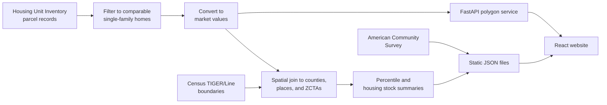

# Utah Home Values Explorer

[](https://github.com/darrenrs/utah-home-values/actions/workflows/ci.yml)

A data pipeline and interactive website for exploring single-family home values and affordability metrics for counties, cities, and ZIP Code Tabulation Areas in Utah based on public data sources. Currently available live at https://darrenskidmore.com/projects/utah-home-values.

## Features

- Fully deterministic data pipeline based on five official data sources
- Responsive website design with data visualizations, with support for counties, cities/CDPs, ZIP Code Tabulation Areas, and the Wasatch Front
- Rankings page for cities/CDPs, ZIP codes, and counties, allowing a target budget or percentile input for quick comparison, with CSV download
- Zoomable choropleth map of median home values by county, city/CDP, or ZIP code
- Home value lookup that shows where a value ranks in the selected area, plus a CSV download of every percentile
- Side-by-side comparison of two areas, with the parent county's distribution shown for context
- Housing stock (year built and lot size) and affordability context for every area
- Support for custom areas defined by GeoJSON polygons allowing deeper neighborhood/census tract analysis

## How It Works



1. `pipeline/generate_data.py` reads the Housing Unit Inventory and keeps comparable single-family homes (see [the filters](#utah-housing-unit-inventory)).
2. It converts each home's assessed value to an estimated market value:

   ```
   market value = assessed value / assessment_sales_ratio * hpi_ratio
   ```

   The assessment/sales ratio corrects for how far each county's assessments run from sale prices. The HPI ratio moves the value from the county's January 1 assessment date to the average prices of the market-value year (currently 2025). Both are set per county in `config/counties.yml`.
3. It places each home in the Census county, place, and ZIP Code Tabulation Area containing it, and writes the 1st–99th percentiles, housing stock summaries, and simplified boundaries as static JSON. `pipeline/download_acs_tables.py` adds income and tenure estimates. The output format is documented in [docs/DATA.md](docs/DATA.md).
4. The website loads those files in the browser. The optional FastAPI service summarizes custom polygons with the same filters and calculations.

## Setup

This section will guide users on how to set up this project locally.

### Initial

Run each of these commands:

1. `git clone https://github.com/darrenrs/utah-home-values`.
2. `cd utah-home-values/`
3. `python3 -m venv .venv`
4. `source .venv/bin/activate`
5. `pip install -r requirements.txt`
6. `mkdir -p data/raw/`
7. `cp .env.example .env`

Then, populate each value in .env.

### Geodatabase

Run this command (from the project root directory):

8. `python3 -m pipeline.download_hui`

This downloads the latest published Utah Housing Unit Inventory as a File Geodatabase to `data/raw/HousingUnitInventory.gdb` and prints its last-modified date and record count. The download link always serves the latest version, so data from two runs can differ if UGRC published an update in between. If a geodatabase is already there, the script stops; add `--replace` to overwrite it.

To download it manually instead, go to https://opendata.gis.utah.gov/datasets/utah-housing-unit-inventory/about, click "Download", then "Download" under File Geodatabase. Extract the ZIP, then move its `{long-guid-text}.gdb` folder to `data/raw/` and rename it to `HousingUnitInventory.gdb`.

### Pipeline

Run each of these commands (from the project root directory):

9. `python3 -m pipeline.download_shapefiles`
10. `python3 -m pipeline.generate_data`
11. `python3 -m pipeline.download_acs_tables`

Data artifacts will be generated in `PROJECT_ROOT/website/public/data`. This process must be re-run when data are updated.

### Build Site

Run each of these commands (from the project root directory):

12. `cd website/`
13. `npm ci`
14. `npm run build`

The site will be built as a React/Vite single-page application in `PROJECT_ROOT/website/dist`. If data have been updated, the site must be rebuilt.

### Polygon API

The Polygon API uses Uvicorn as a server to interface between the FastAPI application and the browser. Run this command (from the project root directory):

15. `uvicorn api.app:app --reload`

The API loads and filters the geodatabase before it starts accepting requests, which takes a while. `/api/health` responds once the API is ready.

In development (`npm run dev`), the website uses `http://127.0.0.1:8000/api` by default. Production builds only enable custom areas when `VITE_FASTAPI_BASE_PATH` is set, such as `https://example.com/projects/utah-home-values/api`.

#### Example Usage

Submit a GeoJSON Polygon, Feature, or FeatureCollection in longitude and latitude coordinates. An example is provided below:

```bash
curl -X POST http://127.0.0.1:8000/api/polygon \
  -H 'Content-Type: application/json' \
  --data '{"type":"Polygon","coordinates":[[[-112.06,41.17],[-112.06,41.19],[-112.04,41.19],[-112.04,41.17],[-112.06,41.17]]]}'
```

The response contains assessed and market-adjusted summaries using the same filtering and percentile calculations as the static website data. If less than 90% of the matching housing units share the same assessed year, the API will still contain the assessed summary but it will not be accessible in the website. For privacy reasons, requests containing fewer than 100 housing units are rejected with a 403 status code.

## Data Sources

### Utah Housing Unit Inventory

All parcel-level/value data are provided for public use by Utah Open Data as part of the [Utah Housing Unit Inventory](https://gis.utah.gov/products/sgid/planning/housing-unit-inventory/) dataset. Parcels which correspond to single- and multi-family housing units are aggregated by county assessors and submitted to the dataset. As of the October 14, 2026 update, the dataset includes the core Wasatch Front — Salt Lake, Utah, Davis, and Weber counties — along with Tooele, Morgan, and Washington counties.

A [live service](https://opendata.gis.utah.gov/datasets/utah-housing-unit-inventory/about) is available on ArcGIS. This is where updated geodatabases will be available.

As part of the pipeline, outlier or non-single-family records from this dataset are dropped. The filters include:
```
- SUBTYPE = single_family
- IS_OUG != 1
- UNIT_COUNT = 1
- 50_000 <= TOT_VALUE <= 20_000_000
- TOT_BD_FT2 <= 30_000 (missing or zero is allowed, see below)
- 0 < ACRES <= 100
- ACRES >= 0.05 for homes built in 2000 or later
- no other kept record shares an identical parcel footprint
```

Townhomes and condos are excluded because counties report them inconsistently: most counties submit them as grouped records (`IS_OUG = 1` and/or `UNIT_COUNT > 1`), while Utah County submits them as individual units. Including them would make cross-county comparisons inconsistent. The lot-size floor and shared-footprint rule remove townhome, twin-home, and PUD units that are subtyped as `single_family`. Homes built before 2000 are exempt from the lot-size floor because small older lots are mostly genuine detached cottages.

Square footage (`TOT_BD_FT2`) is not comparable across counties: some report above-grade area only, others include basements. It is therefore not used as a measure, and it is often missing for recent builds whose values are already complete. A home with missing or zero square footage is kept only if its value is at least 50% of the median value of homes *with* square footage in the same county, city, and build year (or the same county and build year when the city has fewer than 10 such homes). This keeps finished homes and excludes unfinished homes carrying land-only or partial values.

Places and ZIP Code Tabulation Areas with fewer than 20 matching homes are not published, because their percentiles would effectively describe individual parcels. ZIP Code Tabulation Areas with less than half their area inside the covered counties are not published either, because they would describe only a fringe of the ZIP code (for example, the Washington County edge of Cedar City's 84720).

Places and ZIP Code Tabulation Areas can span counties with different assessment years. A geography only gets an assessed year when at least 90% of its homes share that year (the same rule the Polygon API uses). Otherwise the website hides its assessed view, because values from different assessment years aren't comparable.

### Utah Assessment/Sales Ratio Studies

Assessment/Sales ratios are provided by the Utah State Tax Commission. Each county uses the Residential median from the study published the year after its `assessed_value_year` in `config/counties.yml`, because the study published in year Y+1 matches sales to the January 1, Y assessments. The current values come from the [2024](https://files.tax.utah.gov/propertytax/srs/srs2024.pdf) (Utah County) and [2025](https://files.tax.utah.gov/propertytax/srs/srs2025.pdf) (Davis, Morgan, Salt Lake, Tooele, and Weber) studies. Washington County's 2026 assessments use the [2026](https://files.tax.utah.gov/propertytax/srs/srs2026.pdf) study as a stand-in until the 2027 study is published.

### FHFA House Price Index

The FHFA All-Transactions House Price Index, provided by the Federal Reserve Bank of St. Louis (FRED), is a repeat-sales index of single-family home prices. It is used to bring each county's assessed values forward to estimated 2025 market values.

Utah assesses property as of January 1 of the assessment year, but FHFA county indices are only published annually, as calendar-year averages. So each county's `hpi_ratio` in `config/counties.yml` combines the county annual index with a timing correction from the metro-area quarterly index:

```
hpi_ratio = [county_annual(2025) / county_annual(Y)] * [metro_avg(Y) / metro_jan1(Y)]
metro_jan1(Y) = mean(metro Q4 of Y-1, metro Q1 of Y)
```

Here `Y` is the county's `assessed_value_year`. `config/market_context.yml` sets the year the market-adjusted values represent and holds the latest metro quarterly index values, which the website uses for a "prices since" note. That note never changes published values. The source series and values for each county are recorded as comments in `config/counties.yml`. Washington County's assessed values (2026) are newer than the latest county annual index, so its ratio uses the St. George metro quarterly index only.

### Census TIGER/Line Shapefiles

Place names and boundaries are provided by the U.S. Census Bureau from the [2024 Census TIGER/Line Shapefiles](https://www.census.gov/geographies/mapping-files/time-series/geo/tiger-line-file.2024.html). This method is used over the Housing Unit Inventory's existing CITY field for the following reasons:

- Extending support to geography groupings beyond counties and cities
- Adding support to CDPs (census-designated places) such as Stansbury Park and Mountain Green
- Addressing missing values in the CITY field, such as the January 2026 data update having blank values for parcels in Orem

### American Community Survey Data

American Community Survey data from the 2020-2024 5-year estimates are provided by the U.S. Census Bureau via the [Census API](https://www.census.gov/data/developers.html). The tables used are [Median Household Income in the Past 12 Months (B19013)](https://data.census.gov/table?q=B19013) and [Tenure (B25003)](https://data.census.gov/table?q=B25003). This is used for reporting home affordability ratios.

## Limitations

- **Estimates for groups, not appraisals.** The values describe the distribution of homes in an area. They aren't an estimate for any one home.
- **Single-family homes only.** Counties report townhomes and condos inconsistently, so they are excluded everywhere.
- **County-wide adjustments.** Each county has one assessment/sales ratio and one price index. Neighborhoods or price tiers that the assessor values more or less accurately than the county median are adjusted the same way.
- **Assessment timing.** Counties assess in different years. Assessed values are only comparable within a county; use market-adjusted values to compare across counties.
- **New construction lags.** Homes built after each county's `latest_year_built_with_value` are left out until their values are complete.
- **Square footage isn't used.** Some counties include basements in `TOT_BD_FT2` and others don't.
- **Income is a few years older.** The ACS 5-year estimates (2020–2024, in 2024 dollars) are older than the home values, so price-to-income ratios run slightly high.
- **ZIP Code Tabulation Areas aren't ZIP codes.** They approximate USPS ZIP code areas. A few extend into counties the dataset doesn't cover; those mostly inside covered counties are published with only their covered homes counted, and the rest are left out.

## Updating the Data

The sources update on different schedules: the Housing Unit Inventory a few times a year, the price index and ratio studies yearly, and the ACS each December. [docs/UPDATING.md](docs/UPDATING.md) lists the steps for each, including the config values to change in `config/counties.yml` and `config/market_context.yml`. Field descriptions are at the top of each config file.

## Testing

There is a test suite that covers common scenarios and essential guardrails.

- `tests/test_api.py` - Tests that the API loads its data at startup, returns valid data, and rejects invalid requests.
- `tests/test_polygon_summary.py` - Tests some valid and invalid GeoJSON polygons.
- `tests/test_validate_data.py` - Tests the home filters, the missing-square-footage cohort rule, the small-area and assessed-year rules, the market context and housing stock summaries, that empty output and missing required columns are rejected, and that failed updates, total record count drops of more than 1%, or drops of more than 5% in any one county do not overwrite existing known good data.
- `tests/test_housing_loader.py` - Tests that broken source geometries are repaired or rejected when the geodatabase is loaded.
- `tests/test_acs_tables.py` - Tests that unavailable Census values become `null` without dropping the rest of the row.
- `tests/test_download_hui.py` - Tests that the geodatabase download finds the `.gdb` folder in the ZIP and never replaces an existing geodatabase without `--replace`.

### Running Tests

Please run the test suite whenever contributing or updating the source data. From the project root directory:

1. `pip install -r requirements-dev.txt`
2. `python3 -m pytest`
3. `cd website && npm run typecheck`

GitHub Actions runs the tests, the type check, and a production build on every push to `main` and on every pull request.

## Copyright

(C) 2026 Darren R. Skidmore.
